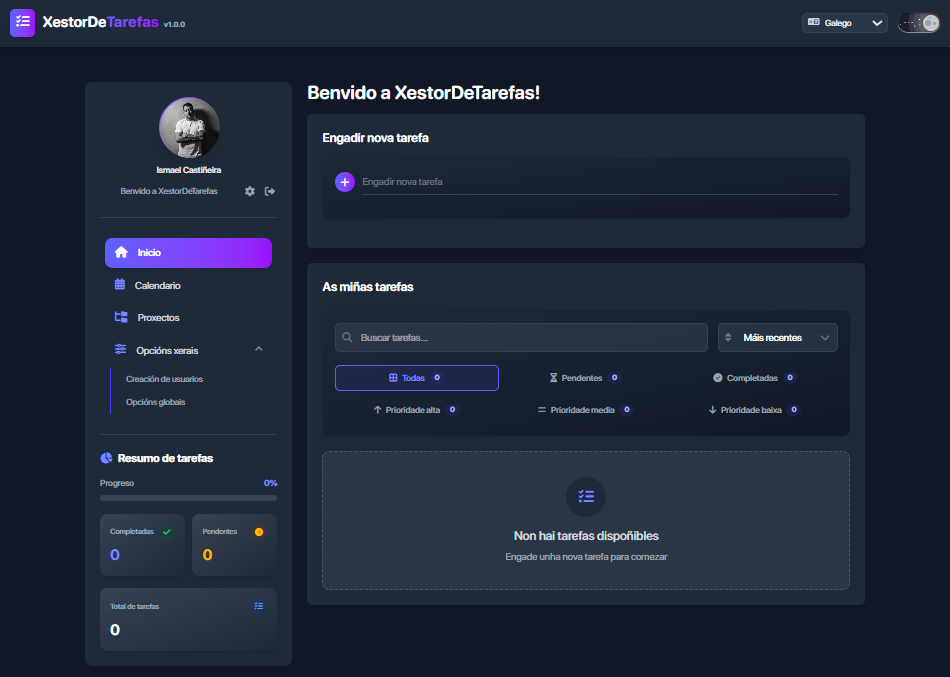
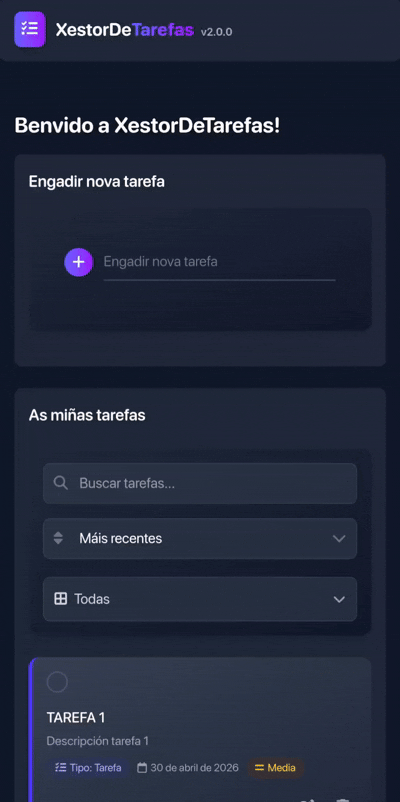

<div align="center">


<br>

**Aplicación de xestión persoal de tarefas e proxectos**

Planifica o teu día, crea e completa tarefas, agrupa o traballo por proxectos e cliente,
garda notas e listas de comprobación, e revisa todo no calendario.

<br>

[](LICENSE)
[](https://nodejs.org)



&nbsp;
&nbsp;


</div>

## Por que

As aplicacións de tarefas comerciais pídenche unha conta nun servidor alleo, gardan os teus
datos onde non ves, e tarde ou cedo poñen detrás dun pago o que antes era gratis.
XestorDeTarefas nace da idea contraria: **a app é túa e os datos tamén**.

## Funcionalidades

- ✅ Xestión de tarefas: crear, editar, eliminar, completar, buscar, filtrar e ordenar.
- 📝 Módulo de notas: notas de texto e notas tipo lista/checklist con recordatorios.
- 📅 Vista de calendario anual/mensual con sincronización con Google Calendar.
- 📁 Xestión de proxectos con datos de cliente.
- 👥 Xestión de usuarios.

## Configuración

### Requisitos

- Node.js 18+ (recomendado 20+)
- npm
- Windows, Linux ou macOS

### 📅 Calendarios de Google (iCal)

- Cada usuario pode engadir ata 3 calendarios en Axustes de usuario co "enderezo secreto en formato iCal" de Google Calendar.
- Cada calendario gárdase no dispositivo: non se volve descargar durante 10 minutos e, se falla a descarga, amósase a última copia gardada cun aviso.

### 🔒 KDBX (KeePass)

- A lectura de KDBX está dispoñible desde Proxectos.
- Cada usuario configura a ruta e o contrasinal da súa base en Axustes de usuario, debaixo dos calendarios iCal. Gárdase co resto dos datos do usuario.

### Scripts

Todos os comandos `npm` execútanse dende a carpeta `app/`.

| Script | Que fai |
| --- | --- |
| `npm run dev` | Web en modo desenvolvemento |
| `npm run build` | Compila a web en `dist/` |

## Estrutura xeral

```text
xestor-de-tarefas/
├─ app/                               # Todo o código da app (web, escritorio e Android)
│  ├─ config/
│  │  ├─ apiLocal.js                  # /api/kdbx/read e /api/ical (compartido por Vite e escritorio)
│  │  ├─ vite.config.js               # Vite + React + Tailwind + /api/kdbx/read + /api/ical + modo android
│  ├─ public/
│  │  └─ Images/                      # Logo, banner e capturas do README
│  ├─ src/
│  │  ├─ App/
│  │  │  ├─ store.js                  # configureStore + rexistro de slices
│  │  │  ├─ persistence.js            # Firestore: coleccións, migración e escrituras por elemento
│  │  │  ├─ sincronizacion.js         # Middleware de Redux, cola de pendentes e escoita en tempo real
│  │  │  ├─ autenticacion.js          # Login, contas e contrasinais con Firebase Auth (e modo local)
│  │  │  └─ firebase.js               # Inicialización de Firebase (Firestore + Auth)
│  │  ├─ Components/                  # UI por áreas (*.android.jsx = versión da app)
│  │  │  ├─ Auth/                     # LoginView, CambioContrasinal
│  │  │  ├─ Layout/                   # Header, Sidebar, UserSettingsView
│  │  │  ├─ Tasks/                    # TasksList, TaskItem, TaskForm, TaskFilter
│  │  │  ├─ Projects/                 # ProjectsView (con lectura KDBX)
│  │  │  ├─ Notes/                    # NotesView (notas de texto e checklist)
│  │  │  ├─ Calendar/                 # CalendarView (anual/mensual/diaria)
│  │  │  ├─ Options/                  # OptionsGlobalView, OptionsUsersView
│  │  │  └─ UI/                       # DarkMode, ToastCenter e compoñentes comúns
│  │  ├─ Features/                    # Slices Redux Toolkit
│  │  │  ├─ Tasks/tareasSlice.js
│  │  │  ├─ Projects/proxectosSlice.js
│  │  │  ├─ Notes/notasSlice.js
│  │  │  ├─ Users/usuariosSlice.js
│  │  │  ├─ Theme/temaSlice.js
│  │  │  └─ Language/idiomaSlice.js
│  │  ├─ i18n/
│  │  │  └─ translations.js           # Traducións gl / es / en
│  │  ├─ Assets/                      # Fontes SF Pro e Font Awesome
│  │  ├─ Styles/DarkMode.css          # Estilos do tema escuro
│  │  ├─ Utils/                       # plataforma.js (esApp), toast.js e ical.js (carga de calendarios)
│  │  ├─ App.jsx                      # Compoñente raíz e enrutado de vistas
│  │  ├─ main.jsx                     # Punto de entrada (Provider + render)
│  │  └─ index.css                    # Estilos base + Tailwind
│  ├─ index.html                      # HTML raíz de Vite
│  ├─ jsconfig.json                   # Alias @ → /src
│  ├─ .env / .env.example             # Credenciais de Firebase
│  └─ package.json                    # Scripts npm (execútanse dende app/)
├─ LICENSE
└─ README.md
```

## Evolución por versión

### v1.0.0

- Primeira versión estable da web.
- Tarefas: crear, editar, eliminar, completar, buscar, filtrar e ordenar.
- Proxectos con datos de cliente e lectura de credenciais KeePass (KDBX).
- Notas de texto e de lista, con cor, fixadas arriba, orde arrastrando e recordatorios.
- Calendario anual, mensual e diario, con ata 3 calendarios de Google (iCal) por usuario.
- Usuarios con idioma, tema e xénero por defecto, e xestión de usuarios para administradores.
- Inicio de sesión con Firebase Authentication e sincronización dos datos con Firestore.
- Interface en galego, castelán e inglés, con tema claro e escuro.


## Autor

[Ismael Castiñeira](https://ipardelo.es)

```bash
VIVA GHALISIA E A COSTA DA MORTE! 💀
```